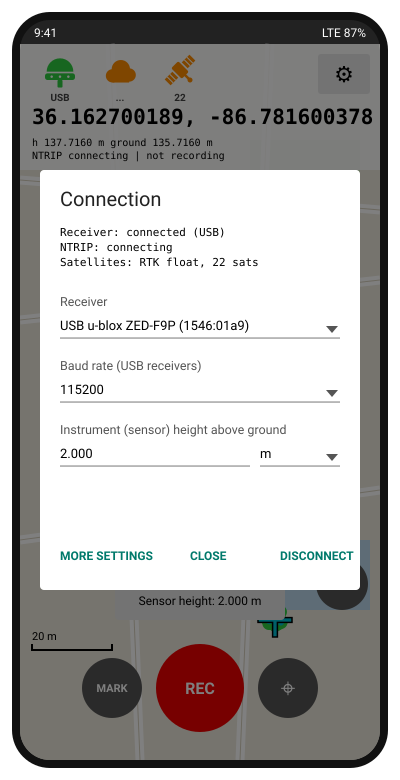
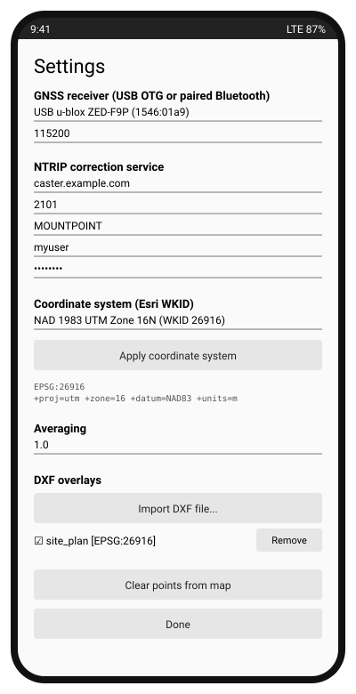

# GNSS RTK Logger (Android)

An Android app for surveying-style point capture with an **external GNSS receiver** (USB OTG, Bluetooth, or Bluetooth LE), **real-time NTRIP corrections**, and a **live map**. Built and targeted for a Samsung Galaxy S8 (Android 7–9, `minSdk 24`), but it should run on any modern Android phone.

> **Status:** early version. The screens below are **illustrative mockups** drawn to show the layout, not real screenshots. Please test with your own receiver before relying on it for real work.

## Screens

| Main screen, recording | After STOP | Connection popup | Settings |
|---|---|---|---|
|  |  |  |  |

### Main screen (map)
- OpenStreetMap background; zooms to your position on the first fix.
- **Dots** are recorded points. The **ring** shows the fix quality: **green** = RTK fixed, **orange** = RTK float, **gray** = anything else (GPS/DGPS).
- The **fill color** of a dot shows the **recording period** it belongs to. It changes each time you start a new recording (cycles through 9 colors).
- A **scale bar** sits at the bottom left. It shows metres, or feet if the sensor height unit is ft or ftUS.
- **Plus sign (+)** = the weighted average of a recording where the antenna stayed put (see [Averaging](#averaging-stationary-recordings)).
- **Black outer ring** = a point you marked with MARK. The newest point is drawn larger while recording.
- DXF drawings you imported are drawn underneath the points.
- **Status icons** at the top: a **receiver**, a **cloud** (NTRIP corrections) and a **satellite**.
  - Receiver: grey = not connected, orange = connecting, green = connected. The number inside is the data rate coming from the receiver, in bits per second (4.8k = 4800 bps).
  - Cloud: grey = no NTRIP connection (or not configured), orange = connecting or retrying, green = receiving corrections. The number inside is the RTCM data rate in bits per second.
  - Satellite: grey = no fix, orange = float (or a non-RTK fix), green = RTK fixed. Inside: satellites used over satellites seen (for example 24 over 31). "Seen" needs GSV output from the receiver; without it only the used count is shown.
  - Tapping any icon opens the **connection popup**: Connect/Disconnect, receiver dropdown, baud rate dropdown (USB) and instrument height with its unit. *More settings* opens the full Settings screen (NTRIP login, BLE scan, and so on).
- Below the icons: your position (lat/lon, WGS84) in large type that fills the screen width, then ellipsoidal and ground height, NTRIP status, point count, receiver and RTCM data rates (bits per second), and easting/northing when a projected coordinate system is selected. Fix type shows in the satellite icon color and the satellite count in its label; HDOP is in the CSV files. The gear opens Settings.
- **Connecting and recording are separate.** Connect first to watch the icons turn green and wait for an RTK fix. **REC** then starts a recording period, and **STOP** ends it while staying connected. If you press REC while disconnected it connects first.
- A **Sensor height** button above the record buttons shows the current pole height and lets you change it between recordings.
- Bottom buttons: **MARK** (save a named point), **REC / STOP** (start or stop recording; it **vibrates** and **blinks** while recording), **⌖** (recenter on your position).
- **FIT** (right side) zooms the map to the extents of the latest recording. Long-press it to fit everything: all recordings plus visible DXF overlays.

### Settings
Receiver, NTRIP login, sensor height, coordinate system, averaging threshold, DXF overlays. Changes are saved automatically and apply the next time you connect or press REC.

## Quick start

1. **Pair or plug in the receiver.**
   - *Bluetooth (classic):* pair it in Android Settings first.
   - *Bluetooth LE:* no pairing needed. In Settings tap *Scan for BLE devices* (Android asks for Location permission, and Location must be on), then pick the receiver.
   - *USB:* connect with a USB-C OTG adapter. Use a powered hub if the receiver draws more than the phone can supply.
2. **Receiver setup:** enable **GGA**, **RMC** and **GSV** (satellites in view) NMEA output on the port you use, and allow **RTCM3** input on the same port (on u-blox, enable these on the USB or UART protocol settings).
3. Open Settings (gear) and enter the NTRIP host/port/mountpoint/user/password and your coordinate system. Then tap any status icon at the top, pick the receiver (and baud rate for USB), and tap **Connect**.
4. Wait for the icons to turn green (the satellite icon is green at RTK fixed), then tap **REC**. The first time over USB, Android asks for permission to use the device. Tick "always".
5. Walk, or stay still on a point. Tap **MARK** to save named points (P1, P2, …). Tap **STOP** when done.

## Output files

Everything is saved in the app's folder: `Android/data/com.example.gnsslogger/files/` (visible over USB file transfer or the Files app; the exact path is shown at the bottom of Settings).

| File | Contents |
|---|---|
| `gnss_log_<UTC stamp>.csv` | Every valid fix of one recording |
| `gnss_log_<UTC stamp>_points.csv` | Points you marked (same columns plus `name`) |
| `gnss_averages.csv` | One row per averaged stationary recording (shared across recordings) |

**Log columns:** `utc_time, lat_wgs84_deg, lon_wgs84_deg, ellipsoidal_height_m, msl_altitude_m, geoid_sep_m, fix_quality, fix_name, satellites, hdop, diff_age_s, diff_station, crs, easting, northing, sensor_height_m, ground_ellipsoidal_m, ground_msl_m`

**Average columns:** `start_utc, end_utc, n_fixes, duration_s, lat_wgs84_deg, lon_wgs84_deg, ellipsoidal_height_m, sd_horiz_m, sd_vert_m, pct_rtk_fixed, radius95_m, crs, easting, northing, sensor_height_m, ground_ellipsoidal_m, ground_msl_m, log_file`

Latitude and longitude are always the receiver's WGS84 output. The ellipsoidal height is the MSL altitude plus geoid separation from the GGA sentence.

**Sensor height:** enter the height from the ground mark to the antenna reference point in Settings, or tap the *Sensor height* button on the map screen (before pressing REC; it is locked while recording). It can be in metres, international feet or US survey feet. It is subtracted from the antenna heights to give `ground_ellipsoidal_m` and `ground_msl_m`; the original antenna heights stay in `ellipsoidal_height_m` and `msl_altitude_m`. Lat/lon are not shifted (a plumb pole is assumed, with no tilt correction). If your receiver reports the antenna phase center rather than the ARP, include that offset in the value you enter.

## Coordinate system

Settings → *Coordinate system (Esri WKID)*.

- Presets: WGS 1984 lon/lat (4326), WGS 1984 UTM with automatic zone, Web Mercator (102100), NAD 1983 UTM zones 10N–19N.
- **Custom:** type a WKID (`26917`, `2263`, `102629`), an `EPSG:`/`ESRI:` code, or a full `+proj=...` string. *Apply* validates it and shows the parameters.
- Effects: adds `crs`, `easting`, `northing` columns to the CSVs, shows E/N on the map screen, and is how imported DXF coordinates are interpreted.
- WKIDs that equal an EPSG code work directly. Esri-only codes depend on the projection library's built-in list; use a `+proj` string if one is missing.
- RTK positions are in the datum of your correction network (for example ITRF or NAD83 realizations), which can differ from WGS84 by up to a metre or two. Transform if that matters for your work.

## DXF overlays

Settings → *Import DXF file…*

- Supports **ASCII DXF**: LINE, POLYLINE, LWPOLYLINE, ARC, CIRCLE, POINT, TEXT/MTEXT, with layer and entity colors. Text labels appear when zoomed in.
- Not supported: binary DXF, DWG, block inserts (INSERT), splines, hatches, and arc bulges on polylines (drawn straight).
- Coordinates are read in the coordinate system selected in Settings (units such as US survey feet are handled by the projection). If the drawing lands in the wrong place or the import fails, remove it and re-import with the correct system.
- Overlays are saved inside the app and reload at startup. Use the checkbox to hide one, or *Remove* to delete it.

## Averaging (stationary recordings)

When you press **STOP** and the antenna stayed put, the app saves a **weighted average** position:

- "Stayed put" means 95% of the fixes are within the *stationary threshold* of the average (default **1.0 m**, set in Settings) and there are at least 5 fixes.
- Weights favor quality: RTK fixed counts most, RTK float much less, DGPS/GPS barely at all, each divided by HDOP².
- The result is appended to `gnss_averages.csv` and drawn as a **plus sign (+)** in the recording's color. The status bar reports the number of fixes and the standard deviation, or "Moved too much to average" with the measured radius.

## Building

Requirements: Android Studio (Hedgehog or newer) or JDK 17 with Gradle 8.x, Android SDK 34, and internet access for the first sync (dependencies come from Maven Central and JitPack).

```
# Android Studio: File > Open the GnssLogger folder, then Run
# Command line:
gradle assembleDebug --no-daemon
# APK: app/build/outputs/apk/debug/app-debug.apk
```

`gradle.properties` must contain `android.useAndroidX=true` (already included), because the USB serial library depends on AndroidX.

To install on the phone, enable Developer options and USB debugging and press Run, or copy the APK over and allow installs from unknown sources.

Libraries: [usb-serial-for-android](https://github.com/mik3y/usb-serial-for-android), [osmdroid](https://github.com/osmdroid/osmdroid), [proj4j](https://github.com/locationtech/proj4j).

## Limitations

- Recording continues while you switch between the map and Settings, but there is **no background service**: the screen is kept on while the app is open, and locking the phone or leaving the app may stop recording.
- Map tiles need internet (previously viewed tiles are cached). Recording and logging work offline except for NTRIP.
- **BLE** receivers must expose a UART-style GATT service: Nordic UART, HM-10 style (FFE0/FFE1), u-blox SPS, or any service with one notify and one write characteristic. BLE throughput is lower than classic Bluetooth or USB; if RTK corrections seem to lag, use USB or classic Bluetooth.
- To keep the map fast, a new dot is drawn only after you move about 1 cm or the fix type changes. The CSV still gets every fix.
- The app does not run on-device compile checks or unit tests yet. Treat it as a starting point.

## Project layout

```
app/src/main/java/com/example/gnsslogger/
  MainActivity.kt      map screen, REC/MARK buttons, point overlay
  SettingsActivity.kt  receiver, NTRIP, coordinate system, averaging, DXF import
  Session.kt           receiver link (USB/Bluetooth), NTRIP client, NMEA parsing, CSV logging, averaging
  Proj.kt              coordinate system handling (proj4j)
  Dxf.kt               ASCII DXF parser and map overlay
docs/                  mockup screens used in this README
```

## Troubleshooting

| Problem | Try |
|---|---|
| No devices listed | Plug in or pair the receiver, then tap *Refresh device list* |
| BLE scan finds nothing | Grant Location permission, switch Location on, and make sure the receiver is advertising (not connected to another phone) |
| "BLE: no serial (UART) service" | The receiver does not expose a UART-over-BLE service; use USB or classic Bluetooth |
| BLE connect fails (status 133) | Turn Bluetooth off and on, then retry; keep the phone close to the receiver |
| "USB permission denied" | Replug the receiver and accept the Android prompt |
| NTRIP "caster replied: 401" | Check username, password and mountpoint |
| Fix stays GPS, never RTK | Check the receiver accepts RTCM3 on the same port, and that NTRIP shows *streaming* |
| Network/VRS mountpoint gives no data | Make sure GGA output is enabled; the app sends it to the caster every 10 s |
| DXF in the wrong place | Remove it, set the correct coordinate system, re-import |
